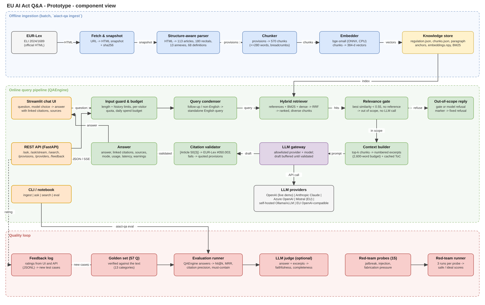
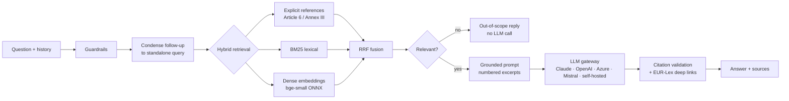

# EU AI Act Q&A – natural-language interface over Regulation (EU) 2024/1689

Ask questions in plain language about the **EU Artificial Intelligence Act** and get answers that are grounded in the
official EUR-Lex text, with **verified citations** (`[Article 6(2)]`, `[Annex III]`, `[Recital 27]`) linking to the
exact provision.

```
$ aiact-qa ask "What are the maximum fines for prohibited AI practices?"
Non-compliance with the prohibitions in Article 5 can be fined up to EUR 35 000 000 or, for undertakings, up to 7 %
of total worldwide annual turnover for the preceding financial year, whichever is higher [Article 99(3)] …
Sources:  [1] Article 99(1)-(3) - Penalties  https://eur-lex.europa.eu/eli/reg/2024/1689/oj/eng#099.001
```
<sub>(illustrative LLM answer; without an API key the engine returns the cited provisions verbatim)</sub>

## Deliverables

| Deliverable | Where |
|---|---|
| Solution architecture (draw.io, 2 pages: prototype components with inputs/outputs; target production) | [`docs/architecture.drawio`](docs/architecture.drawio) · previews [`architecture.png`](docs/architecture.png), [`architecture_production.png`](docs/architecture_production.png) |
| Solution design (components, data model, decisions, guardrails, production mapping) | [`docs/solution_design.md`](docs/solution_design.md) |
| Feasibility, roadmap, effort estimation, running costs | [`docs/feasibility_and_effort.md`](docs/feasibility_and_effort.md) |
| Prototype code (Python package, API, UI, CLI) | [`src/aiact_qa`](src/aiact_qa), [`app/ui.py`](app/ui.py) |
| Executed notebook walkthrough | [`notebooks/AI_Act_QA_Prototype.ipynb`](notebooks/AI_Act_QA_Prototype.ipynb) |
| Evaluation set + results | [`data/eval/golden_qa.jsonl`](data/eval/golden_qa.jsonl), [`reports/`](reports) |
| Key AI-assistant prompts and validation | [`docs/ai_assistant_usage.md`](docs/ai_assistant_usage.md) |



## How it works



* **Structure-aware ingestion** – the EUR-Lex HTML is parsed by its element ids into 113 articles (numbered
  paragraphs and points), 180 recitals, 13 annexes and 68 definitions with chapter/section context; chunks never
  cross a provision, so citations are exact.
* **Hybrid retrieval** – explicit references, BM25 and local embeddings fused with Reciprocal Rank Fusion.
* **Provider-agnostic generation** – Anthropic Claude (default `claude-opus-5-5`), OpenAI, Azure OpenAI, Mistral AI
  (EU), self-hosted open-weights models (Ollama/vLLM: Mistral, EuroLLM, Teuken, Llama…), any OpenAI-compatible
  endpoint (e.g. Scaleway, OVHcloud, IONOS), or no LLM (extractive mode). Selectable per request.
* **Guardrails** – relevance gate, citation validation with warnings, prompt-injection-aware prompt, rate limiting,
  optional API key, disclaimer.
* **Evaluation** – 57-question golden set verified against the text; retrieval and answer metrics; optional LLM judge.

### Retrieval quality on the golden set (49 answerable standalone questions)

| Strategy | hit@8 | recall@8 | MRR |
|---|---|---|---|
| BM25 only | 0.90 | 0.88 | 0.74 |
| Dense only | 0.92 | 0.91 | 0.78 |
| BM25 + dense (RRF) | 0.96 | 0.94 | 0.80 |
| **Hybrid + reference resolver (default)** | **0.98** | **0.96** | **0.83** |

## Quick start

```bash
python3 -m venv .venv && . .venv/bin/activate
pip install -e ".[dev,notebook]"
cp .env.example .env          # add ANTHROPIC_API_KEY (or another provider's key) – optional
aiact-qa ingest               # parse + chunk + embed (≈1 min on CPU; downloads the 130 MB ONNX model once)
aiact-qa ask "Is a CV-screening tool a high-risk AI system?"
aiact-qa ask "What must a chatbot disclose?" --provider mistral        # any configured provider
aiact-qa search "deep fake labelling"                                   # retrieval only
aiact-qa serve                 # REST API on :8000, OpenAPI docs at /docs
aiact-qa ui                    # Streamlit chat on :8501
aiact-qa eval --provider anthropic --judge                              # golden-set evaluation
make test                      # 23 tests
```

Without any API key everything still runs: answers fall back to **extractive mode** (the most relevant provisions,
quoted and cited).

### REST API

| Method | Path | Purpose |
|---|---|---|
| GET | `/health` | status, index statistics, active LLM |
| GET | `/providers` | configured LLM providers |
| POST | `/ask` | `{question, history?, top_k?, provider?, model?}` → answer, sources, citations, usage |
| POST | `/ask/stream` | same, as Server-Sent Events (`sources` → `delta`… → `done`) |
| POST | `/search` | retrieval only |
| GET | `/provisions/{id}` | full text of `art_5`, `rct_27`, `anx_III` … |
| POST | `/feedback` | thumbs up/down + comment (JSONL) |

## Deployment (Docker behind Traefik)

The compose file is meant for a host that **already runs Traefik** as reverse proxy. It publishes no host ports,
does not include nginx, and does not touch other stacks on the host (e.g. n8n). The containers only join Traefik's
external network.

```bash
cp .env.example .env    # AIACT_HOST, TRAEFIK_NETWORK (see `docker network ls`), TRAEFIK_CERT_RESOLVER, LLM key
docker compose up -d --build
# UI:  https://$AIACT_HOST/      API: https://$AIACT_HOST/api/health , /api/docs
```

Routing: `Host(AIACT_HOST)` → Streamlit UI; `Host(AIACT_HOST) && PathPrefix(/api)` → API (prefix stripped,
rate-limited). The image bakes in the parsed text, chunks, embeddings and the embedding model, so containers start
in seconds.

## Repository layout

```
src/aiact_qa/
  ingestion/   build.py (fetch, snapshot, build), parser.py (EUR-Lex HTML → provisions), chunker.py
  retrieval/   references.py, bm25.py, dense.py, hybrid.py (RRF fusion)
  generation/  prompts.py, llm.py (Claude), providers.py (OpenAI, Azure, Mistral, Ollama, …), citations.py
  evaluation/  dataset.py, metrics.py, runner.py, judge.py
  pipeline.py  QAEngine – single entry point for API, UI, CLI, notebook, evaluation
  api.py, cli.py, config.py, models.py, schemas.py
app/ui.py                   Streamlit chat
data/raw/                   EUR-Lex snapshot of OJ L 2024/1689 (sha256 recorded in the index)
data/eval/golden_qa.jsonl   golden set (generated by scripts/make_golden_set.py, checked by verify_golden_set.py)
notebooks/                  executed walkthrough
docs/                       architecture (draw.io + renders), design, feasibility & effort, AI-assistant usage
tests/                      pytest suite
```

## Configuration

All settings are environment variables (prefix `AIACT_`, see [`.env.example`](.env.example)): provider and model,
embedding model, optional re-ranker, `top_k`, relevance threshold, API key, Claude effort and refusal fallbacks.

## Limitations

Single regulation in English (original 2024 text, no consolidated amendments); multi-hop questions spanning unrelated
provisions can miss one provision; LLM answer quality must be measured per provider with `aiact-qa eval`. Details in
[`docs/solution_design.md`](docs/solution_design.md#7-known-limitations-of-the-prototype).

## Source and disclaimer

Text: Regulation (EU) 2024/1689, Official Journal of the European Union, L series, 12.7.2024 – © European Union,
[EUR-Lex](https://eur-lex.europa.eu/eli/reg/2024/1689/oj/eng); reuse authorised with acknowledgement of the source.

This is an informational prototype. Its answers are **not legal advice**; always verify against the official text.
