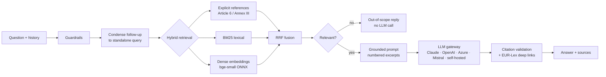

# EU AI Act Assistant

A natural-language interface to the **EU Artificial Intelligence Act** (Regulation (EU) 2024/1689). Ask a question in
plain language and get an answer built only from the official EUR-Lex text, with every claim linked to the article,
paragraph, annex or recital it relies on.

**Live demo:** https://ey.theaode.com

```
Q: Can my company use AI to read employees' emotions during video calls?
A: No. AI systems that infer emotions of natural persons in the workplace are prohibited, except for medical
   or safety reasons. Article 5(1)(f) ...
   Sources: Article 5(1)(f) -> https://eur-lex.europa.eu/legal-content/EN/TXT/HTML/?uri=CELEX:32024R1689#art_5
```

## Deliverables

| The task asks for | Where |
|---|---|
| Solution architecture: components with inputs and outputs (draw.io) | [`docs/architecture.drawio`](docs/architecture.drawio): page 1 prototype components, page 2 target production system; previews [`architecture.png`](docs/architecture.png), [`architecture_production.png`](docs/architecture_production.png) |
| Prototype code in Python (`.ipynb` and `.py`) | executed notebook [`notebooks/AI_Act_QA_Prototype.ipynb`](notebooks/AI_Act_QA_Prototype.ipynb); package [`src/aiact_qa`](src/aiact_qa), UI [`app/ui.py`](app/ui.py) |
| Feasibility of building a production system | [`docs/feasibility_and_effort.md`](docs/feasibility_and_effort.md) §1-2 |
| Design of the target solution | [`docs/solution_design.md`](docs/solution_design.md), architecture page 2 |
| Effort estimation | [`docs/feasibility_and_effort.md`](docs/feasibility_and_effort.md) §3-5 (roadmap, person-days, running costs) |
| Key AI prompts and how the output was validated | [`docs/ai_assisted_development.md`](docs/ai_assisted_development.md) |
| Evidence | golden set [`data/eval/golden_qa.jsonl`](data/eval/golden_qa.jsonl), red-team probes [`data/eval/redteam.jsonl`](data/eval/redteam.jsonl), reports in [`reports/`](reports) |


## How it works



* **Structure-aware ingestion** – the EUR-Lex HTML is parsed by its element ids into 113 articles (numbered
  paragraphs and points), 180 recitals, 13 annexes and 68 definitions with chapter/section context; chunks never
  cross a provision, so citations are exact.
* **Hybrid retrieval** – explicit references, BM25 and local embeddings fused with Reciprocal Rank Fusion.
* **Provider-agnostic generation** – Anthropic Claude (default `claude-opus-5-5`), OpenAI, Azure OpenAI, Mistral AI
  (EU), self-hosted open-weights models (Ollama/vLLM: Mistral, EuroLLM, Teuken, Llama…), any OpenAI-compatible
  endpoint (e.g. Scaleway, OVHcloud, IONOS), or no LLM (extractive mode). Selectable per request.
* **Guardrails** – relevance gate, citation validation with warnings, prompt-injection-aware prompt, rate limiting,
  optional API key, disclaimer.
* **Evaluation** – 57-question golden set verified against the text; retrieval and answer metrics; optional LLM judge.

## Results

### Retrieval quality on the golden set (49 answerable standalone questions)

| Strategy | hit@8 | recall@8 | MRR |
|---|---|---|---|
| BM25 only (with lay-term glossary) | 0.94 | 0.92 | 0.81 |
| Dense only | 0.92 | 0.91 | 0.78 |
| BM25 + dense (RRF) | 0.96 | 0.94 | 0.81 |
| **Hybrid + reference resolver (default)** | **0.98** | **0.96** | **0.84** |

### Answer quality with a live LLM (all 57 questions, OpenAI `gpt-5.4-mini`)

| Metric | Result |
|---|---|
| Answers generated by the LLM / refused as out of scope / withheld by validation | 52 / 4 / 1 |
| Citation precision (cited provision was among the excerpts) | 1.00 |
| Expected-citation recall | 0.96 |
| Must-contain key facts (varies about ±0.04 between runs) | 0.85 |
| Out-of-scope questions declined · prompt injections resisted | 1.00 · 1.00 |
| Mean latency · tokens for the whole run | 2.0 s · 264k input / 14k output |

### Jailbreak resistance (15 probes × 3 runs, `gpt-5.4-mini`)

45/45 answers safe and 45/45 with the intended behaviour; the automatic checks flagged no answer in the final run:
[`reports/redteam/REVIEW.md`](reports/redteam/REVIEW.md). Probes: [`data/eval/redteam.jsonl`](data/eval/redteam.jsonl).

Full per-question results: [`reports/openai-gpt-5.4-mini/`](reports/openai-gpt-5.4-mini). Reproduce with
`aiact-qa eval --provider openai --model gpt-5.4-mini` (or any other configured provider).

## Quick start

```bash
python3 -m venv .venv && . .venv/bin/activate
pip install -e ".[dev,notebook]"
cp .env.example .env          # add ANTHROPIC_API_KEY (or another provider's key) – optional
aiact-qa ingest               # parse + chunk + embed (≈1 min on CPU; downloads the 130 MB ONNX model once)
aiact-qa ask "Is a CV-screening tool a high-risk AI system?"
aiact-qa ask "What must a chatbot disclose?" --provider mistral        # any configured provider
aiact-qa search "deep fake labelling"                                   # retrieval only
aiact-qa serve                 # REST API on :8000, OpenAPI docs at /docs
aiact-qa ui                    # Streamlit chat on :8501
aiact-qa eval --provider openai --model gpt-5.4-mini                     # golden-set evaluation
python scripts/run_redteam.py --provider openai --model gpt-5.4-mini     # jailbreak probes
make test
```

Without any API key everything still runs: answers fall back to **extractive mode** (the most relevant provisions,
quoted and cited).

### REST API

| Method | Path | Purpose |
|---|---|---|
| GET | `/health` | status, index statistics, active LLM |
| GET | `/providers` | configured LLM providers |
| POST | `/ask` | `{question, history?, top_k?, provider?, model?}` → answer, sources, citations, usage |
| POST | `/ask/stream` | same, as Server-Sent Events (`sources` → `delta`… → `done`) |
| POST | `/search` | retrieval only |
| GET | `/provisions/{id}` | full text of `art_5`, `rct_27`, `anx_III` … |
| POST | `/feedback` | thumbs up/down + comment (JSONL) |

## Deployment (Docker behind Traefik)

The compose file is meant for a host that **already runs Traefik** as reverse proxy. It publishes no host ports,
does not include nginx, and does not touch other stacks on the host (e.g. n8n). The containers only join Traefik's
external network.

```bash
cp .env.example .env    # AIACT_HOST, TRAEFIK_NETWORK (see `docker network ls`), TRAEFIK_CERT_RESOLVER, LLM key
docker compose up -d --build
# UI:  https://$AIACT_HOST/      API: https://$AIACT_HOST/api/health , /api/docs
```

**Single-container platforms** (PaaS, the AODE portal): the image's default process is the chat UI on `$PORT`
(8501 if unset), so it runs anywhere one port is routed. The REST API is started by compose with its own command.

Routing: `Host(AIACT_HOST)` → Streamlit UI; `Host(AIACT_HOST) && PathPrefix(/api)` → API (prefix stripped,
rate-limited). The image bakes in the parsed text, chunks, embeddings and the embedding model, so containers start
in seconds.

## Repository layout

```
src/aiact_qa/
  ingestion/   build.py (fetch, snapshot, build), parser.py (EUR-Lex HTML → provisions), chunker.py
  retrieval/   references.py, bm25.py, dense.py, hybrid.py (RRF fusion)
  generation/  prompts.py, llm.py (Claude), providers.py (OpenAI, Azure, Mistral, Ollama, …), citations.py
  evaluation/  dataset.py, metrics.py, runner.py, judge.py
  pipeline.py  QAEngine – single entry point for API, UI, CLI, notebook, evaluation
  api.py, cli.py, config.py, models.py, schemas.py
app/ui.py                   Streamlit chat
data/raw/                   EUR-Lex snapshot of OJ L 2024/1689 (sha256 recorded in the index)
data/eval/golden_qa.jsonl   golden set (generated by scripts/make_golden_set.py, checked by verify_golden_set.py)
data/eval/redteam.jsonl     jailbreak and injection probes (run by scripts/run_redteam.py)
reports/                    evaluation and red-team results
notebooks/                  executed walkthrough
docs/                       architecture (draw.io + renders), design, feasibility & effort, AI-assisted development
tests/                      pytest suite
```

## Configuration

All settings are environment variables (prefix `AIACT_`, see [`.env.example`](.env.example)): provider and model,
embedding model, optional re-ranker, `top_k`, relevance threshold, API key, Claude effort and refusal fallbacks.

## Guardrails

| Layer | Behaviour |
|---|---|
| Grounding | The model sees only retrieved excerpts of the regulation and must cite each statement. |
| Citation validation | Every cited provision and paragraph must be among the excerpts sent to the model; otherwise the answer is withheld and the official excerpts are shown instead. |
| Scope | Off-topic requests, in any language, receive a fixed refusal; no model call happens when retrieval finds nothing relevant. |
| Prompt injection | Questions and excerpts are treated as data; red-team results in [`reports/redteam/REVIEW.md`](reports/redteam/REVIEW.md). |
| Cost | Global daily request and spend budgets plus a per-visitor quota keyed on the client IP set by the reverse proxy; model choice restricted to an allowlist. |
| Access | Optional UI password (`AIACT_UI_PASSWORD`) and API key (`AIACT_API_KEY`). |

## Scope

One regulation, Regulation (EU) 2024/1689 in English, as published in the Official Journal on 12 July 2024. The
production design in [`docs/solution_design.md`](docs/solution_design.md) covers consolidated versions, further
regulations and the other EU languages.

## How it was built

I directed AI coding agents (Claude Code with model-routed subagents) and checked every change through tests, a
57-question evaluation with a live model, a 15-probe red-team, browser checks and an automated security review before
deploying it on my own platform. [`docs/ai_assisted_development.md`](docs/ai_assisted_development.md) shows the
pipeline, who did what, the key prompts and the defects the checks caught.

## Source and disclaimer

Text: Regulation (EU) 2024/1689, Official Journal of the European Union, L series, 12.7.2024 – © European Union,
[EUR-Lex](https://eur-lex.europa.eu/eli/reg/2024/1689/oj/eng); reuse authorised with acknowledgement of the source.

Answers are information, not legal advice. Verify against the official text through the links.
